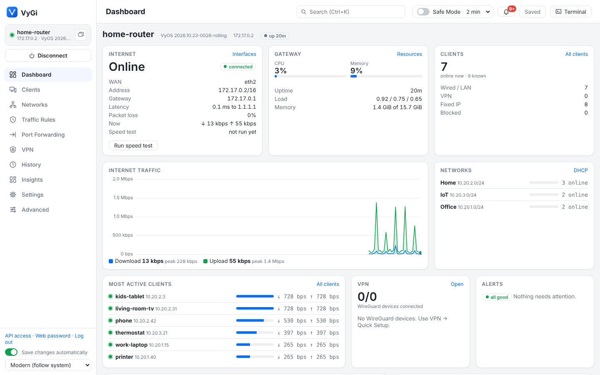
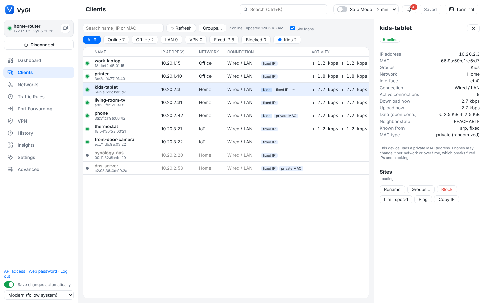
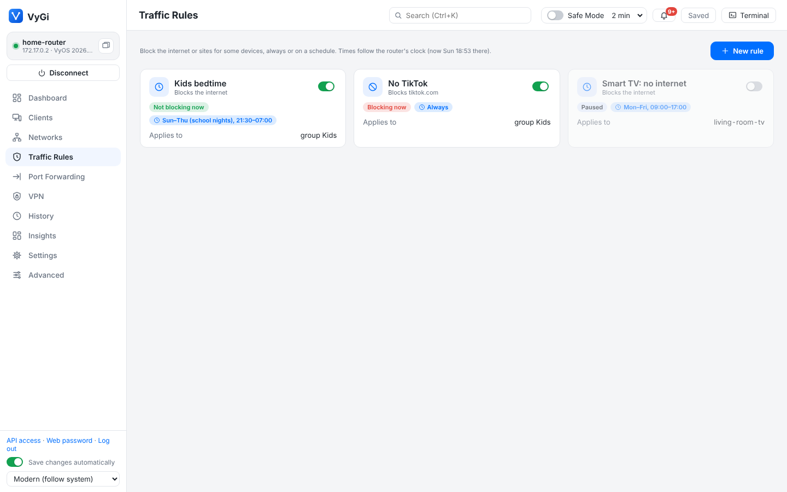
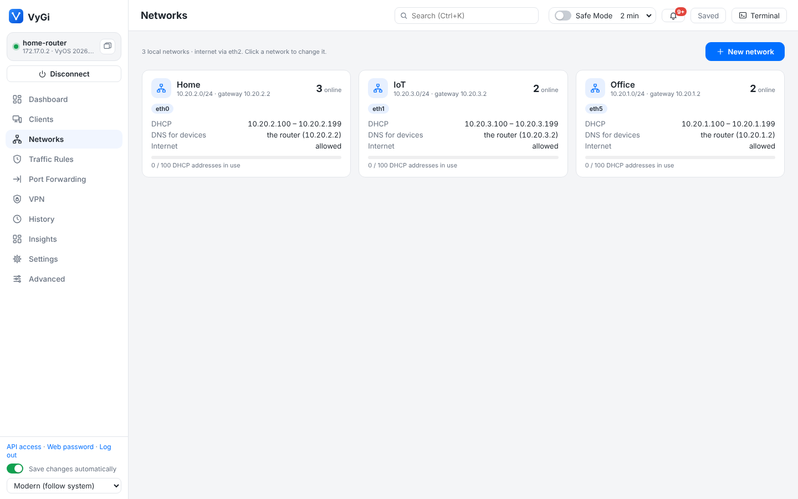
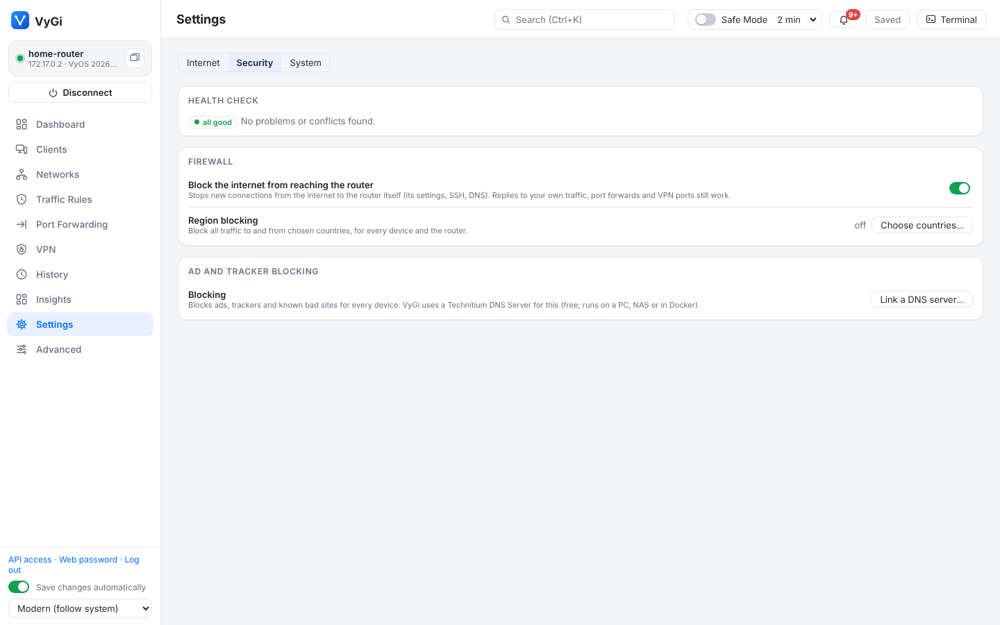
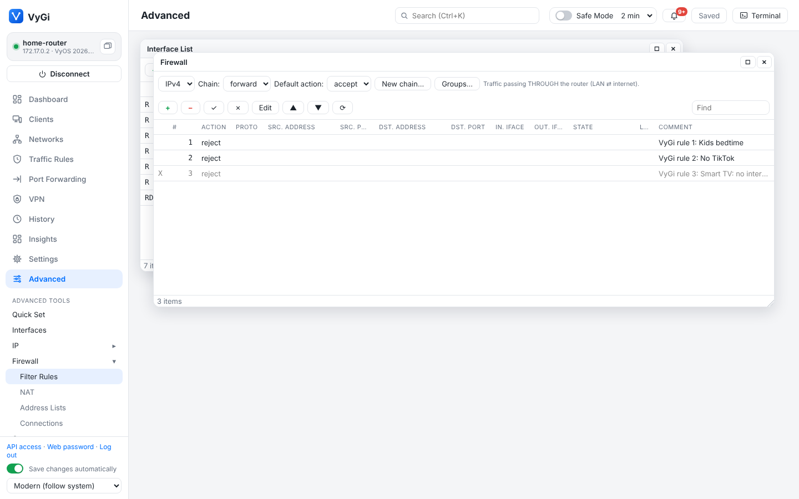
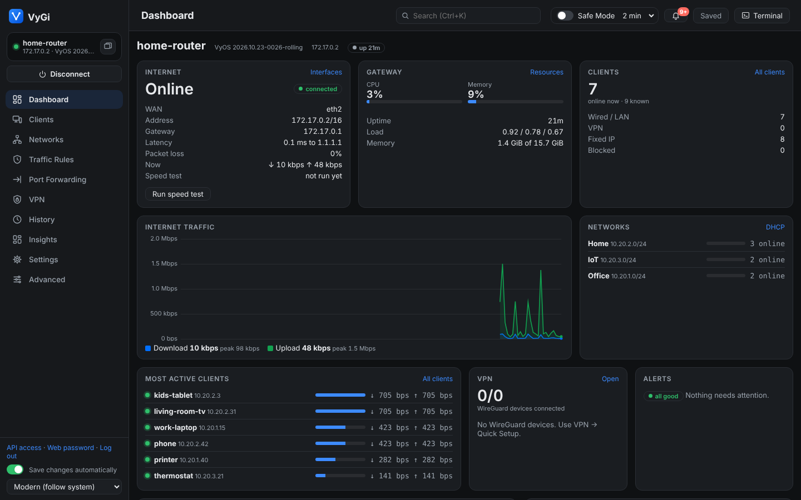

# VyGi

A Winbox-style desktop app for managing [VyOS](https://vyos.io) routers. It runs on Windows, macOS and Linux and is built with Tauri (a Rust backend with a web UI).

It talks to the router in two ways:

- **HTTPS REST API**: reads and changes the configuration, commits (including Safe Mode), saves, and runs `show` commands.
- **SSH**: the terminal, live interface traffic, routes, WireGuard peers, the log stream, ping, traceroute and packet capture.

Targets current VyOS (1.5 / rolling). The API calls were checked against `vyos-1x/src/services/api/rest/routers.py`.



| | |
|---|---|
|  |  |
| **Clients**: every device, live speeds, groups, fixed IPs | **Traffic Rules**: block the internet or sites, on a schedule |
|  |  |
| **Networks**: VLANs, ports and bridges, DHCP and isolation | **Settings**: Internet, Security and System, UniFi-style |
|  |  |
| **Advanced**: Winbox-style windows for everything else | Light, dark and Classic (Winbox gray) themes |

Screenshots: the web version against a VyOS test router (rolling, in a container) with a few simulated devices.

## Two ways to work

The sidebar has **Home, Devices, Network, Security, Activity, System** and **Advanced**. Network, Security, Activity and System hold several pages, shown as tabs under the top bar:
- **Network:** Internet, Local Networks, VPN.
- **Security:** Traffic Rules, Network Policies (who can reach whom, device discovery), Port Forwarding, Content Filtering (region and ad blocking), Intrusion Prevention.
- **Activity:** Traffic & Logs (web version: traffic, data usage, connections, the system log), Changes & Backups.
- **System:** Router (Health Check, router access, name and time, updates, backups), VyGi (who's logged in, API tokens and Claude, 24/7 watching and alerts, showing changes before applying).

- **Set up your router** (the welcome page, while no router is saved): the steps on the router itself, before VyGi can reach it: install VyOS (and remove the installer), then the console commands for the address you choose (address, default route, DNS server, SSH), generated with a Copy button; **Connect** opens the Connect dialog with that address filled in. The Connect dialog doesn't pop up on its own until a router is saved.
- **Make it a router** (Network → Internet, the setup checklist, or search "make it"): one form for the internet port (keep the current connection, automatic/DHCP, PPPoE or a fixed address, optional VLAN tag), the home network (an existing network, or a new one on free ports, several ports bridged) and its address range. It sets up DHCP, the router as DNS server, NAT to the internet and the basic firewall (block new connections from the internet to the router and, with IPv6, to your devices; DNS answers only for your networks; SSH guessing protection) as one change, always shown before it's applied, with Safe Mode. Running it on a router that's already set up changes nothing. If VyGi connects through the port chosen for the internet, it says so first and leaves blocking that side for later (blocking it would cut VyGi off).
- **Set up this router** (System → Router, or search "setup"): a checklist of the basics (internet, a home network, a fixed address for the router, VyGi's own router login, the router's password, the security check, saving automatically, backups and alerts, the time zone), each with its state and a button to where it's fixed. It opens by itself the first time VyGi connects to a router that is missing one of them. "Make it fixed" turns the DHCP address VyGi reaches the router on into a fixed one (keeping the gateway and DNS server DHCP gave it); the address drops for a few seconds while VyOS switches. "Make one" creates the router login `vygi` with an Ed25519 SSH key only VyGi keeps (no password anyone knows) and switches to it; the router keeps its backups, history and alerts. (Every VyOS login can change everything, so this is for a separate password and a clear history, not a limit on VyGi.) (A `vygi` login made by an older VyGi with a password gets **Use a key** to switch.) The checklist opens once more on routers set up before it gained these items, if any of them isn't done. Restoring a backup or undoing to a point from before VyGi's own login existed keeps that login: VyGi adds it to the old settings before loading them (and checks afterwards), so a restore can't lock VyGi out. Changes that would remove VyGi's login or its key get a warning first.
- **Lockout check:** a change that would take away the address VyGi reaches the router on (removing or changing it, turning off DHCP without a fixed address, disabling the port) gets a warning before it's applied.
- **Connection problems:** when the router's API doesn't answer, VyGi tries SSH and says which it is: the router isn't reachable at that address at all, or only its API is off, with a button to turn the API back on over SSH, or to restore a backup over SSH (for a router that restarted without its settings: VyGi copies the backup's config.boot over, loads it and saves it; a backup much smaller than the one before it is marked, as it's likely the lost settings).
- **What can it reach?** (Clients → a device): for the internet, each other network and the internet coming in, the rule that decides, the rules that only block some of it (a schedule, some sites, ports, countries) and exceptions, each tagged with the page that made it. VyGi walks the router's IPv4 forward chain (and the custom chains it jumps to) the way the firewall does for a new connection.
- **Preview before applying:** changes that touch several things (a new network, a policy that renumbers rules) first show what they'll do in plain words (Add / Change / Remove / Turn on / Turn off, the object, the page that owns it, the fields), with the VyOS commands folded underneath. Settings → System → Changes switches it to always or never; the conflict checks still show whenever they find something.
- **Your routers** (Dashboard, web version, two or more routers saved): each router's 24/7 watching state, when it was last checked and today's alerts, with **Open** to connect to it in a new tab.

- **Pages** (UniFi-style), in the sidebar:
  - **Dashboard:** internet status and latency, live WAN traffic, CPU and memory, clients online, networks with DHCP pool use, the busiest clients, top sites and countries, VPN devices and alerts.
  - **Clients:** every device the router knows about (from ARP, DHCP, fixed IPs, local DNS names and WireGuard). Click a device for details and to **Wake up** an offline one (Wake-on-LAN), **Rename** it, give it a **Fixed IP**, **Limit speed**, **Block** it, or **Ping** it.
  - **Device groups** (Clients → Groups…): named sets of devices (e.g. Kids, Smart TVs), kept on the router as MAC groups. Traffic Rules and the VPN client can target a group and follow it: add a device to the group and every rule applies to it. A group can carry a speed limit per device (needs fixed IPs, since speed limits match IP addresses; VyOS's MAC matching for queues drops all but one address and doesn't work for uploads). The Clients page shows group tags and filters by group.
    - **Per-device speeds:** live download/upload per device, here and on the Dashboard. This needs per-connection traffic counting, which VyOS leaves off; Clients has a one-click **Turn on traffic counting** (sets `system sysctl parameter net.netfilter.nf_conntrack_acct value 1`).
    - **Sites:** where each device's traffic goes, with site icons, the network owner and the country. Site names (e.g. YouTube, github.com) come from Technitium's query log. Without it, traffic is grouped by network owner (e.g. Google, Fastly). Countries and owners come from DB-IP Lite (IP data by DB-IP, db-ip.com, CC BY 4.0), downloaded once (about 18 MB) and looked up locally. Icons are downloaded from each site itself and cached; they can be turned off in Clients.
  - **Settings** (UniFi-style), in three tabs. Anything set up by hand (Advanced, the CLI) is shown as such and left alone; every change goes through the conflict check.
    - **Internet:** the internet port, address (with a warning when another router sits in front), gateway, Dynamic DNS and a speed test; **Smart Queues** (CAKE shaping uploads to 90% of your line, so big uploads don't make games and calls lag; VyOS can't CAKE-shape downloads); **upstream DNS** (Auto from your provider, Cloudflare, Quad9, Google or custom); **Backup internet (WAN2)** failover with the live state of both lines (see below).
    - **Internet:** the connection (automatic/DHCP, PPPoE with username and password, or a fixed address; an optional VLAN tag for providers that need one; IPv6 from the provider by DHCPv6 prefix delegation, one /64 per chosen network with router advertisements). Changing it moves every rule that names the internet interface (NAT, firewall, port forwards, Smart Queues, failover, Dynamic DNS) to the new one.
    - **Security → Network Policies → Who can reach whom** (UniFi's policy table): a grid of which networks may start connections to which (from isolation, plus the internet), and policies that allow or block traffic from a network, device group or device to a network or a device with a fixed IP, optionally only some ports or ping. Policies are checked first (VyGi keeps them in front of isolation and Traffic Rules, renumbering only its own rules), so an allow is an exception to an isolated network. Tested with real traffic between networks.
    - **Security → Network Policies → Device discovery across networks (mDNS)**: the router repeats mDNS (Chromecast, AirPlay, printers, smart-home hubs) between the networks you choose. An isolated network gets an exception for mDNS in front of its "isolate router" block (the Health check puts it back if editing the network removed it); casting into an isolated network also needs a policy that allows it. If a chosen network has no IPv6, VyGi repeats IPv4 only (VyOS refuses otherwise). Tested with a real mDNS query from the IoT network repeated onto the Home network.
    - **Networks → Ports** (UniFi's topology/port manager for one router): the internet line, the router, and a card per physical port with its cable state, speed, role (internet, network, bridge member, unused), networks and VLANs, any switch or access point announcing itself there (LLDP), and the devices behind it (on bridges, the port the bridge last saw each device on). Click a device to open it on Clients.
    - **Security → Intrusion Prevention (IDS/IPS)**: runs [Suricata](https://suricata.io) (open source, the engine behind most home-router IDS) in a container on the router (`docker.io/jasonish/suricata:8.0.6`, pinned), watching the ports you choose with the free Emerging Threats Open rules (**Update rules** downloads the newest). Recent alerts are listed with their level, source and destination; **Block** puts an internet address in a drop group (traffic to the router and through it). With 24/7 watching, serious and suspicious alerts become alerts and phone notifications, and **Block attackers automatically** blocks internet addresses behind a serious attack for 24 hours (local devices are never blocked). Suricata needs about 1 GB of free memory and disk and internet access for its image and rules; VyGi sets a 1 GB memory limit (VyOS's default of 512 MB is too little), turns off its statistics log and rotates its logs at 50 MB so the router's disk can't fill. Claude can read the alerts (`ids_alerts`). Detection only: traffic isn't held up waiting for Suricata. **Not yet tested with Suricata itself**: the test setup can't download it. VyOS accepted the container setup (host networking, capabilities, memory, folders, arguments) and alert reading, manual and automatic blocking were tested with real-format alert lines.
    - **Security:** the Health check; **VyGi access** (web version: activity log, API tokens, web password, logged-in browsers); **block the internet from reaching the router**; **region blocking**; **ad and tracker blocking** through a linked Technitium DNS Server (adds the StevenBlack list only when it has none).
    - **System:** router name and time zone; **VyOS updates** (checks the router's own `system update-check url` first and, for rolling builds, the public nightly lists from the VyOS docs; **Update now** saves the settings, installs the new image next to the current one and asks before restarting. **Automatic way back:** before the restart VyGi leaves a note and a boot script on the router (`/config/vygi-rollback*`, hooked into `/config/scripts/vyos-postconfig-bootup.script`). When the new version starts, it waits 10 minutes; if VyGi hasn't reached the router by then (the 24/7 watcher, or a VyGi window connecting), the router makes the old version the default and restarts into it, and VyGi tells you when it reconnects. Reaching the router is the test, so a new version that's reachable but broken in some other way is kept: **Go back…** under Updates then restarts into the previous version. The old version also stays selectable under Advanced → System → Images); backups; 24/7 watching and notifications (web version).
  - **Networks:** every local network as a card (subnet, gateway, VLAN, devices online, DHCP pool use). **New network** sets up a VLAN, a spare port, or several ports bridged together (they then work like one switch) with gateway, DHCP, DNS, internet access (NAT) and optional **isolation** in one go. Presets are **Standard**, **Guest** (internet only, can't reach your devices or the router's settings) and **IoT** (isolated, no internet). Isolation, and internet on/off for a network, are firewall rules VyGi labels "VyGi net …"; editing or deleting a network updates them. A bridged network's ports can be changed later.
  - **Traffic Rules:** block the internet, or specific sites, for chosen devices or networks, always or on a schedule (e.g. the kids' tablet, Sun–Thu 22:00–07:00). Every rule has an on/off switch and shows whether it is blocking right now. Region blocking is under Settings → Security (VyOS GeoIP firewall matching; DB-IP data the router downloads itself).
  - **Port Forwarding:** let the internet reach one device (game server, NAS, camera). Pick the device, a preset or ports (outside and inside can differ, ranges work), and optionally limit who may connect. VyGi adds the matching firewall rule when the forward chain drops by default, offers to reserve the device's address in DHCP, and warns when the router can't be reached from the internet (carrier-grade NAT, or a modem in front of it). Forwards made elsewhere are listed too; edit those in Advanced.
  - **VPN:** WireGuard servers with their devices: connected or last seen, data used, and where each connects from (country). **Set up VPN** creates the server and shows a QR code for the first device; **Add device** adds more. Devices can be paused or removed. The public address defaults to your Dynamic DNS name, or the router's internet address. **Show config** shows a device's config file and QR code again: VyGi keeps them in its private data folder (they hold the device's private key; VyGi already holds the router's keys). A device added before VyGi kept them gets **Make a new config**: a new key, and the old config stops working.
  - **VPN client** (VPN page, UniFi "Traffic Routes"): connect the router to a VPN provider (Mullvad, Proton VPN, IVPN…) by pasting the provider's WireGuard config, then choose which devices, device groups or whole networks send their internet traffic through it; everything else keeps using your normal line, and traffic between your own networks stays local. **Kill switch** (on by default): if the tunnel is down, those devices get no internet instead of leaking onto the normal line. The provider can't start connections into your network or the router (firewall rules before any of your own). DNS lookups still go through the router; the dialog shows the provider's DNS to set on devices for full privacy. Uses policy routing (`policy route VYGI-VPN`, one routing table per tunnel); IPv4 only.
  - **Changes & Backups** (Activity): every change made with VyGi in plain words ("New rule Kids bedtime", "Pause forward Minecraft"), newest first, each with **Undo**. Undo puts the router back to how it was before that change (through Safe Mode) and lists any later changes that get undone with it. Changes made outside VyGi are listed separately, and below them the **backups** (the whole configuration, newest first) with what changed and Restore; a backup much smaller than the one before it is marked. The list is kept on this computer.
- **Health check** (Dashboard, shown when something needs attention) and **conflict checks**: VyGi's config doctor looks for problems and clashes: networks that overlap, DHCP pools outside their network or containing the router's address, two devices with the same fixed address, a network with no internet (no NAT) or no working DNS, firewall chains that drop replies, the same port forwarded twice, a forward to an address that can change or to a network with its internet off, a VPN port that's closed, two VPN devices with the same address, speed limits or schedules that offloading defeats, and leftovers from deleted VyGi settings. **Before every change** (from any page or Advanced window), VyGi checks what new problems it would cause: fixes that only touch VyGi's own settings are offered as "VyGi will also change these" (ticked, you confirm), anything else is shown as "Worth knowing" and left to you. Settings made by hand (Advanced, the CLI, Claude) are never changed automatically; fixing them from the Health check shows the exact commands and asks first.
- **Security** (part of the Health check): VyOS running from the installer instead of being installed (nothing survives a restart), a nightly (rolling) build, any login on the router that still has the password "vyos" (checked on the router, so password hashes never leave it; other logins get a "Change password" too), devices reachable from the internet over IPv6 (when the router hands out IPv6: the fix drops new connections from the internet port in the IPv6 forward chain, rule 9900), the router being reachable from the internet, DNS answering anyone, the HTTPS API accepting every address, a short API key, SSH without brute-force protection, and Safe Mode rebooting instead of reloading. Each comes with a plain explanation and a one-click fix. The internet fix blocks new connections arriving on the internet port (rule 9900, after your own allow rules, plus an exception for DHCPv6 from your provider); VyGi won't offer it when it is itself connected through that port. The API fix limits `service https allow-client` to your local networks plus the address the router sees VyGi coming from (asked over SSH), so it can't lock VyGi out; it is applied without Safe Mode, because VyOS commits HTTPS API changes in the background and its commit-confirm then undoes them, and VyGi waits for the API to restart (30-50 s). The SSH fix turns on `service ssh dynamic-protection`.
- **Save changes automatically** (bottom of the sidebar, on by default): saves to the boot config right after a change, or after **Confirm** in Safe Mode, so nothing is lost on a restart.
- **Search and actions** (top bar, Ctrl+K): opened empty it suggests common actions; type to find actions (save, Safe Mode on/off, open terminal, Health Check, add a port forward / VPN device / network / traffic rule, switch to another router, add a router, disconnect, light/dark look), pages by their menu names, Advanced tools, everyday words ("password", "open port", "bedtime", "time zone"), devices (name, IP, MAC), networks, traffic rules, port forwards, VPN devices, and any setting in the router's configuration (secrets excluded). Arrow keys and Enter to open.
- **Speed test** (Dashboard, Internet card): the router measures its own internet speed against Cloudflare's speed test servers (8 parallel downloads, then uploads, about 8 seconds each). On a fast line that uses a few GB of data.
- **Alerts** (bell in the top bar): while VyGi is open, even minimized, it checks the router every minute and tells you when the internet goes down or comes back, a new device joins, a Dynamic DNS update fails, the router restarted, or (off by default) a VPN device connects. You can also list devices or servers to **watch** (like RouterOS Netwatch): the router pings them every minute and you're told when one stops answering or comes back. Alerts show as pop-ups, as desktop notifications when VyGi isn't in front, and in the bell's list. Choose which ones you want in that list.
- **Advanced** (Winbox-style): every feature as a floating window you can arrange side by side (the default on a desktop-sized screen; **Tile** lays them all out in a grid; windows stay inside the area, cling to its edges and to each other, and dragging one against the left or right edge fills that half, against the top the whole area, with an outline showing where it will go), or with the **Tabs** switch at the right of the strip, one tab at a time (the default on small screens); **+** shows the tool list. Firewall, NAT and Address Lists have a **Managed by** column: rules and lists made on a simple page are tagged with it (Traffic Rules: Kids bedtime, Port Forwarding: Plex, Networks, Device groups, Intrusion Prevention, …) and the tag opens that page. Changing one of them here asks first: open that page, change it here anyway, or **make it manual** (VyGi stops managing it and it disappears from that page). Tools open from the tool list in the sidebar. Every page has an **Advanced ▾** menu next to its title that opens the related windows (e.g. Clients → DHCP Leases, ARP, Queues; Port Forwarding → NAT). Drag the tool list's edge or a column header's edge to resize them (double-click to reset). Click a column header to sort a table (again to reverse, a third time for the original order); right-click a row for that window's actions (Edit, Enable, Disable, Move up…). On the Clients page, each device has a **⋯** menu (also on right-click) with its actions and the matching Advanced windows.

The sidebar shows the connected router, with a button to open **another window for a second router**. The top bar has the page title, **Safe Mode**, **Confirm** (while a change is waiting), **Save** and **Terminal**. In the Modern look, messages pop up in the corner. On narrow windows the sidebar shrinks to icons (except on Advanced, which needs the tool list). Pages stop polling the router while VyGi is minimized and refresh when you come back. The theme menu at the bottom of the sidebar switches between **Modern** (light, dark, or following your OS) and **Classic** (Winbox gray).

## What it does

| Area | What you get |
|---|---|
| IP → Addresses | Every address on every interface, including ones from DHCP. Add and remove static addresses. |
| IP → ARP / Neighbors | The ARP/NDP table (with static ARP entries), and devices found by **LLDP** (switches, access points, other routers). One click turns LLDP on. |
| IP → Services | SSH, HTTPS API, DNS, DHCP, NTP, LLDP, SNMP, mDNS repeater and more, with on/off, ports and details. You can't switch off the access VyGi itself needs. |
| Firewall → Address Lists, Connections | Address/network/port/MAC groups as editable lists, and the live connection-tracking table with the busiest hosts. |
| System → Resources, Identity & Clock, Images, Reboot / Shut Down | Live CPU and memory graphs, uptime, temperatures and storage. Router name, domain, time zone and NTP servers. Install, set as default and delete VyOS images (VyOS's equivalent of Winbox Packages). Reboot and shut down, with a warning about unsaved or unconfirmed changes. |
| Interfaces → Traffic | A live Rx/Tx graph for one interface. |
| Tools → IP Scan, Profile | Find which addresses in a subnet answer, with MAC addresses and DHCP names. See the router's busiest processes. |
| Interfaces | Live table with flags, type, comment, IPs, MAC, MTU, Tx/Rx rates and a traffic sparkline. You can add VLAN, bridge or dummy interfaces, remove, enable and disable them, and double-click a row to edit it. |
| IP → Routes | The kernel routing table per VRF, for IPv4 or IPv6. You can add and remove static routes. |
| VPN → WireGuard | **Quick Setup** creates a WireGuard server and your first device in one step, optionally opening the firewall port, adding NAT for internet access and DNS for clients. **+ Device** adds more phones and laptops. Each device gets a config file and a **QR code** for the WireGuard app. Keys are generated on your computer, so a device's private key never touches the router. Also shows live peers (handshake age, traffic). |
| VPN → IPsec / OpenVPN | Status. |
| Firewall | Rule table per chain (forward / input / output / custom chains) for IPv4 and IPv6. Add, edit, remove, enable, disable and reorder rules, set the default action (with lock-out warnings), and create custom chains. Groups open in the config editor. |
| NAT | Source NAT (masquerade) and Destination NAT (port forwards) as rule tables with guided forms. |
| IP → DHCP Server | Set up a DHCP server on an interface (pool, gateway, DNS and lease are suggested for you), edit or remove it, see leases, and manage static mappings. **Make Static** turns a lease into a reservation. |
| IP → DNS | The router's own DNS servers, DNS forwarding (the router answers DNS for your network) and static host names. |
| IP → Dynamic DNS | Keep a name like home.example.com pointed at your changing public IP: Cloudflare, DuckDNS, No-IP, Namecheap, Porkbun, DynDNS2-compatible and the other providers VyOS supports. The form only asks for what the chosen provider needs, and checks it the way VyOS will before applying. It shows the last update and registered IP, and has **Update now**. |
| IP → DNS Server (Technitium) | Link a [Technitium DNS Server](https://technitium.com/dns/) to the router (API token, or username/password once to create one). Then:<br>- **Stats**: queries, blocked %, clients, cache hits, failures, a queries/blocked graph and answer types, for the last hour, day, week or month.<br>- **Top clients, top domains, top blocked domains**: block a domain or allow a blocked one with one click. Click a domain to see which devices look it up (or were blocked from it) in the chosen period, with names from the router; double-click a device for its lookups in the Query Log. Needs Technitium's "Query Logs (Sqlite)" app.<br>- **Block / Allow lists**: your own always-blocked and never-blocked domains.<br>- **Blocking**: pause for 5 minutes or 1 hour, turn off or on, and flush the cache.<br>- **Query log**: every query, filtered by device, domain or blocked only. Needs Technitium's "Query Logs (Sqlite)" app.<br>- **Use for LAN**: makes the router's DHCP hand out Technitium as the DNS server, so it sees each device.<br>The Dashboard gets a DNS card, and Clients shows each device's DNS queries with a **DNS log** button. |
| System → Users | Router login accounts: add or remove users, change passwords, add or remove SSH keys. Stops you from deleting the account you're logged in with. |
| Check-up on connect | Every time you connect, VyGi:<br>1. **Backs up** the config to your computer if it changed since last time (last 30 versions kept per router).<br>2. Shows **what changed since your last visit**, as `set` lines, including changes made by others or from the CLI. Secrets are masked.<br>3. Runs a **health check**: uptime and recent reboots, load, memory, disk, interfaces that should be up but aren't, errors logged in the last 24 hours, and whether the running config differs from the saved boot config.<br>The router-state items (unsaved changes, ports without a link, disk, memory, load, logged errors) go into the **Health Check** (Settings → Management) next to the configuration findings, and the pop-up after connecting shows that one count. The window only pops up when there's something to see. Run it any time from System → Check-up. |
| System → Backup / Restore | Save the config to a file on your computer (config.boot or `set` commands), or restore a config.boot backup live, protected by Safe Mode. The **History** tab lists the automatic snapshots, shows what changed in each one, and restores any of them. |
| Protocols, VRF, System, Services | A config tree editor for that section: browse it, set values, delete nodes, and view it as `set` commands. |
| Tools → Torch | Like Winbox Torch: live Tx/Rx rate and packets per second for every conversation on an interface, with totals. Optional tcpdump-style filter; VyGi's own SSH traffic is hidden by default. Also opens from **Interfaces → Torch**. |
| Queues | Like Winbox Simple Queues: a max download and/or upload speed per device (by IPv4 address). Download is shaped on the LAN port (HTB shaper `VYGI-DOWN-<port>`), upload is policed as it arrives (limiter `VYGI-UP-<port>`). VyGi won't touch a port that already has another QoS policy. |
| Tools | Ping, Traceroute, Packet Sniffer (raw tcpdump), IP Scan and Profile. |
| Log | Live system journal with severity and text filters. |
| System → Revisions | Commit history, a colored diff of each commit, and rollback to any revision **without rebooting**. |
| New Terminal | A full SSH terminal (xterm.js). |
| Failed changes | VyOS commits a change section by section, so when one part fails (e.g. an interface the hardware can't create), the parts before it stay applied. VyGi checks the running config after a failure and, if anything changed, puts back the config from just before, so a failed change never leaves half its pieces behind. |
| Safe Mode | Every change is applied with VyOS `commit-confirm`. If you don't press **Confirm** in time, the router reverts it, so a change that cuts you off undoes itself. VyOS allows only one pending confirm at a time. If the pending change is this window's own, VyGi confirms it first (you're evidently still connected) and starts a new timer. If it came from somewhere else (another VyGi window, the command line, another person), VyGi checks before applying anything and asks whether to keep that change; it never confirms it behind your back. After **Confirm**, a reminder offers **Save now**, and disconnecting with unsaved changes asks whether to save first. |
| Save | Commits are live but are lost on reboot until you press **Save**. The button turns red while changes are unsaved. |

### Security

- **HTTPS certificate pinning.** VyOS uses a self-signed certificate. On the first connection the app shows its SHA-256 fingerprint and asks you to trust it. If the certificate changes later, you get a loud warning. TLS verification is never switched off.
- **SSH host key pinning** works the same way.
- **Secrets go to the OS keychain.** The API key and SSH password go to the Windows Credential Manager, macOS Keychain or GNOME Keyring/KWallet. If the keychain doesn't work (e.g. Linux without a keyring service), they go to `secrets.json` in VyGi's config folder instead, readable only by your user account but not encrypted, and VyGi tells you so when you connect. `routers.json` holds only host, ports, user and fingerprints.
- **Local backups contain secrets** (WireGuard keys, password hashes, API keys), just like any VyOS config backup. On macOS and Linux they are created readable only by your user account. Keep the computer secure.
- **No shell injection from the UI.** Interface and VRF names are validated, and capture filters and ping targets are shell-quoted.

## 1. Prepare the router (once)

Log in to the router's console or SSH and run:

```
configure
set service https api keys id vygi key 'PUT-A-LONG-RANDOM-STRING-HERE'
set service https api rest
set service ssh
# Make Safe Mode revert by reloading the old config instead of REBOOTING (VyOS default is reboot):
set system config-management commit-confirm action reload
# Recommended: only allow the API from your admin network
set service https allow-client address 192.168.1.0/24
commit
save
exit
```

To make a random key on Linux or macOS, run `openssl rand -hex 32`.

**Or let VyGi do it:** turn on SSH (`set service ssh`), then in VyGi enter the router's address, login and password and leave the API key empty. VyGi logs in over SSH, runs the commands above with a new random key, saves them and remembers the key.

If you skip the `commit-confirm action reload` line, the app warns you when you connect and offers to set it.

## 2. Get the app

**Easiest:** open the repository's **Actions** tab on GitHub, pick the latest successful **Build** run, and download the installer for your OS from *Artifacts*:

- Windows: `.msi` or `.exe`
- macOS: `.dmg`
- Linux: `.deb`, `.rpm` or `.AppImage`

The builds are not code-signed, so Windows SmartScreen or macOS Gatekeeper will warn you. On macOS, right-click the app → Open.

**Build it yourself:**

1. Install the tools:
   - [Rust](https://rustup.rs)
   - [Node.js 20+](https://nodejs.org)
   - The [Tauri system prerequisites](https://tauri.app/start/prerequisites/) for your OS. On Debian/Ubuntu: `sudo apt install libwebkit2gtk-4.1-dev libssl-dev librsvg2-dev libayatana-appindicator3-dev build-essential`.
2. Build:
   ```
   npm install
   npm run tauri dev     # run it in development mode
   npm run tauri build   # make an installer in src-tauri/target/release/bundle/
   ```

## Run VyGi in Docker (in a browser)

The same app also runs as a web server, so you can use VyGi from any browser (phone included) without installing anything. Put it on an always-on machine at home (a NAS, a mini PC, a Raspberry Pi 4/5 with a 64-bit OS, or the router's neighbour).

```
docker compose up -d          # with the docker-compose.yml from this repository
docker compose logs vygi      # first start only: shows the web password
```

Then open `https://<that machine>:8443`, accept the certificate warning once (VyGi makes its own self-signed certificate), and log in.

- **Image:** `ghcr.io/fearblade66/vygi:latest`, built by CI from this repository. If the package is private on GitHub, either make it public (repository → Packages → vygi → Package settings) or build it yourself: `docker build -t vygi .`
- **Settings** (environment variables):
  - `VYGI_PASSWORD`: the web password (at least 10 characters). Without it, VyGi makes one on first start and prints it in the log; you can change it in VyGi (**Web password** at the bottom of the sidebar).
  - **Logging in:** a login page of its own; a browser stays logged in for 30 days, also across restarts and updates (the logins are kept in `sessions.json` in the data volume, as hashes that can't be used to log in). Logging out, ending a browser under Settings > Management, or changing the password ends them.
  - **Locked out?** After 10 wrong passwords from one address in 5 minutes, that address is refused for 5 minutes (50 from all addresses together refuses everyone); `docker restart vygi` clears it right away. **Forgot the password?** Set `VYGI_PASSWORD` to a new one and restart the container: this also logs every browser out. While `VYGI_PASSWORD` is set it wins at every start, so a password changed inside VyGi goes back to it; remove the line after logging in if you want to change it in VyGi.
  - `VYGI_HOSTNAMES`: extra names or addresses for the self-signed certificate, e.g. `vygi.lan,192.168.1.10` (VyGi remakes its own certificate when this changes). Or replace `tls/cert.pem` and `tls/key.pem` in the data volume with your own (then delete `tls/made-by-vygi-for.txt` so VyGi leaves them alone).
  - `VYGI_TLS=off`: plain HTTP on port 8080, only for running behind your own HTTPS reverse proxy.
  - `VYGI_LISTEN`: address and port (default `0.0.0.0:8443`).
- **Data:** everything lives in the `/data` volume: saved routers, their passwords and API keys (in a file readable only by the container's user; there is no OS keychain on a server), Technitium links, config backups, GeoIP data, site icons, the TLS certificate and the web password hash.
- **Each browser tab** has its own router connection, like the desktop app's windows. A tab that has been closed (or silent for 10 minutes) is disconnected.
- **Security:** whoever can log in to VyGi controls your routers. Use a long password, keep port 8443 inside your home network (reach it from outside through the WireGuard VPN, not a port forward), and keep the data volume private. Logins are limited to 10 wrong passwords per 5 minutes. Sessions last 30 days and end when the server restarts.
- **Differences from the desktop app:** backups download to the browser and restore from an upload.

### Activity log and access (web version)

System → VyGi → **VyGi Access**:

- **Activity log:** logins (and failed ones, lockouts), password changes, API tokens created, revoked or rejected, every change made to a router from VyGi or through the API (Claude), with its commands, Safe Mode confirms and rollbacks, restores, reboots, VyOS updates and terminal sessions. Each entry says who (web session or token), when, from which address and on which router. Passwords and keys in commands are hidden. Kept for 12 months, in the data volume under `audit/` (one JSON-lines file per month), with search.
- **Logged-in browsers:** each one's browser, address, login time and last use; **Log out** ends any other one.
- **Alerts** (through the phone notifications of 24/7 watching): when logins are locked after wrong passwords, when someone logs in from an address not seen before, and when an API token is created.
- **API tokens** work for a set time: Claude's for 4 hours by default (1 hour to 30 days; never only for scripts and the phone app). An ended token keeps its setup: **Allow for 4 hours** under API Access turns it back on, so Claude only gets in when you've opened a window for it. Connect Claude now defaults to read-only.
- Behind your own reverse proxy (`VYGI_TLS=off`), addresses come from `X-Forwarded-For`.

### 24/7 watching (web version)

In the alerts bell, switch on **Watch this router 24/7 on the VyGi server**. From then on the server keeps its own connection to that router (reconnecting by itself, also after a restart) and, every minute:

- runs the alert checks (internet down/back, new devices, Dynamic DNS, router restarts, VPN devices, watched hosts) even when no VyGi tab is open, and sends them to your phone;
- records internet traffic, data used per device (needs traffic counting on the router: Clients → Turn on traffic counting), and the router's system log (followed continuously, so nothing is missed after a reconnect).
- every 6 hours, saves a backup of the router's config when it changed (so changes made outside VyGi are kept too; under `backups/`, the last 30 per router);
- once a day, checks for a new VyOS version and alerts once per new version.

**Flows** (Activity → Traffic & Logs, web version): every connection your devices made, recorded by the 24/7 server when it ends (who, to where, which port/service, data, identical ones merged; lookups to the router itself left out), and every attempt one of VyGi's blocking rules stopped, from the router's firewall log (with the rule that blocked it, e.g. "IoT: isolated" or "Traffic Rule: Kids bedtime"). Blocks are logged only by rules with logging on: the Flows card offers to turn it on for VyGi's blocking rules. Claude can read it with the `get_flows` tool. Kept as long as the rest of the history.

**Activity → Traffic & Logs** shows what was recorded: internet traffic for the last 24 hours, 7 or 30 days; **Data usage**: data used per day (download and upload) over 7 days, 30 days, 3 months or a year, for all devices or one (click a device, or Clients → a device → **Data usage**), with the devices that used the most; and the system log with search and a level filter. History is kept for 30 days (`VYGI_KEEP_DAYS` to change); the daily totals per device, a few KB a day, for a year. All of it is in the data volume under `history/`.

Changing the web password logs out every other browser session.

**Settings changed outside VyGi:** every minute the watcher reads the router's commit log. A commit VyGi didn't make (the command line, another tool) or a Safe Mode undo becomes an alert with who made it and what changed (up to 6 lines like `set service ntp server …`, passwords and keys masked). VyGi's own changes go through the router's HTTPS API and are left out, so another program using that API isn't reported either.

**After a restart:** when the router has started again, the watcher compares its settings with the newest backup before taking any new one. If they differ (a router that didn't load its saved config comes back nearly empty), that's an alert with what's missing or new, so you know to restore the backup.

**Logins to the router:** every SSH or console login to the router that isn't VyGi's own (its login, from its address) is an alert with the login and address, and so is the router's SSH brute-force protection blocking an address, or 5 wrong SSH logins from one address within 10 minutes (at most one alert per address an hour).

**Router can't be reached:** when the watcher can't reach the router for 5 minutes (switched off, lost its address, API and SSH both down), you get an alert with the reason, and another when it's back. Restarts and VyOS updates take less than that, so they don't trigger it.

**Phone notifications:** in the bell, **Phone notifications**. The simplest is [ntfy](https://ntfy.sh): install the free app, subscribe to a topic with a hard-to-guess name (anyone who knows it can read it), and paste its URL (e.g. `https://ntfy.sh/vygi-6f3a9c2e`); or use your own ntfy server, with an access token for protected topics. A webhook URL works too: Discord and Slack webhooks get a message, anything else (Home Assistant, n8n…) gets JSON `{title, text, level, kind, at}`. **Save and test** sends a test message.

The server needs the router's password and API key saved (tick **Remember** when connecting) and the router trusted once from VyGi.

### Android app (web version)

The Docker image includes an Android app (Android 10 or newer): the same pages with a phone layout (tabs at the bottom, the menu behind **More**, windows and dialogs full screen), plus alerts as phone notifications. It's a client of your VyGi server, so it works wherever the server is reachable: at home, or away over your VPN. Router passwords stay on the server.

- **Install:** sidebar → **Phone app** shows a QR code for `https://<vygi>:8443/vygi.apk` and the server's certificate fingerprint. Open the link on the phone (the browser warns about VyGi's self-signed certificate), install the file (Android asks to allow installs from the browser), open VyGi, type the server address (port 8443 is assumed when you leave it out) and check the fingerprint it shows matches. Then log in with the VyGi password.
- **Certificate:** the app trusts exactly the certificate you accepted (a certificate the phone already trusts, from your own reverse proxy, works too). If VyGi makes a new one (for example after `VYGI_HOSTNAMES` changes), the app asks again with the new fingerprint.
- **Notifications:** after login the app makes itself a read-only API token ("Android app (<phone>)", listed under **API access**; revoke it there) and checks the server for new alerts every 15 minutes, the shortest interval Android allows for background work. Serious ones (internet down, attacks) use the "Urgent alerts" channel. 24/7 watching must be on. For instant alerts use ntfy (above) instead or as well.
- **Updates:** when the server has a newer app (after `docker compose pull`), the app offers to install it. Updates install only over an app signed with the same key: the build uses the repository secret `ANDROID_KEYSTORE` (base64 of a `.jks` with key alias `vygi` and password `vygi-android`) when it's set, otherwise a key the build made once and keeps in GitHub's Actions cache (if that cache is ever cleared, uninstall the app once and install the new one).
- **Back** closes the open dialog, menu, window or page, then leaves the app. Files VyGi saves (backups, WireGuard configs) go to **Downloads**. **Change server** is at the bottom of the menu.
- Build it yourself: `cd android && gradle assembleRelease` (Android SDK with platform 35, JDK 17).

### Claude (AI) access

VyGi can be used by Claude, so it can check your setup, explain problems ("why was the internet slow last night?") and make changes for you.

- **Web version (MCP), the easy way:** System → VyGi → **Connect Claude…** (or **API access** → **Connect Claude…**). Choose Claude Code, Claude Desktop or both, what Claude may do and when its access ends. VyGi downloads a setup file; run it once with `node vygi-claude-setup.mjs` on the computer where you use Claude (needs [Node.js](https://nodejs.org) 18 or newer). It saves VyGi's certificate in `~/.vygi/`, checks that it can reach VyGi with the token (and says exactly what to fix if not), adds VyGi to Claude Code (user scope) and/or Claude Desktop's config (keeping a `.before-vygi` copy), then deletes itself because it holds the token. Claude reaches VyGi through [mcp-remote](https://www.npmjs.com/package/mcp-remote) (pinned version), which trusts VyGi's certificate through `NODE_EXTRA_CA_CERTS`. If the address you opened VyGi with isn't in its certificate, the wizard tells you the `VYGI_HOSTNAMES` line to add first.
- **Web version (MCP), by hand:** **API access** at the bottom of the sidebar → **New token**. A **full** token lets Claude read and change settings; a **read-only** one only reads. VyGi shows the token once, with ready-to-paste setup for **Claude Code** (`claude mcp add --transport http vygi https://<vygi>:8443/mcp --header "Authorization: Bearer <token>"`) and **Claude Desktop**. Because VyGi's certificate is self-signed, download it there and start Claude with `NODE_EXTRA_CA_CERTS=<file>`, and make sure `VYGI_HOSTNAMES` includes the address you use (VyGi remakes its own certificate when that changes).
  - Claude gets tools to list routers, read status, devices, the configuration (passwords, keys and secrets redacted), run `show` commands (except ones that print secrets), ping, and read the 24/7 history (alerts, traffic, data per device, logs).
  - Changes always go through **Safe Mode**: they undo themselves after a few minutes unless Claude calls `confirm_changes` after checking the router still works (it then also saves them). The routers' logins, the HTTPS API, the Safe Mode settings, and settings that run commands as root or copy the config elsewhere (task scheduler, event handler, config sync, containers) can't be changed through the API, and whole sections can't be deleted. `get_config` hides passwords, keys (except public keys) and SNMP community names; `show` commands that print secrets (configuration, PKI, tech-support) are refused.
  - Tokens are stored only as fingerprints, can be revoked at any time (which also closes their router connections), and work only from programs, not browsers on other sites. Keep VyGi inside your home network.
- **Any version:** Advanced → System → **Diagnostics Report** makes a Markdown file describing the router (health, interfaces, networks, rules, port forwards, security findings, recent alerts and the configuration with secrets removed) to attach in a chat with Claude.

## 3. Use it

1. Click **Connect**. Fill in the router address, login (usually `vyos`), the SSH password and the API key, then click Connect.
2. Compare the fingerprints it shows with the router before you click **Trust**. On the router:
   - SSH key: `ssh-keygen -lf /etc/ssh/ssh_host_ed25519_key.pub`
   - HTTPS certificate: `show pki certificate`, or `openssl x509 -noout -fingerprint -sha256 -in <cert file>`
3. Leave **Safe Mode** on while you learn. After each change, press **Confirm (m:ss)** once you've checked you still have access. Then press **Save**.

### Backup internet line (failover)

Uses VyOS WAN load balancing in failover mode: the main line is pinged (1.1.1.1) and the backup (9.9.9.9) every few seconds; after 3 failed checks new connections use the backup, and they move back after 3 good checks (open connections are reset when that happens, so they reconnect on the working line). Traffic to private addresses (your own networks) and traffic arriving from either line are left alone; the router's own traffic (DNS, updates) fails over too. The backup port gets its address by DHCP (or a fixed one), its own masquerade from the load balancer, and the same "block new connections from the internet" protection as the main line. Port forwards and the VPN still only work on the main line. Load balancing set up by hand is shown as such and left alone.

## How this differs from the original blueprint

The original plan had a few problems:

- **"VRF header context"**: the VyOS API has no such thing. VRF is a config path (`vrf name X ...`) or a command argument. The Routes window has a VRF selector.
- **`show interfaces json` via the API**: not a real call. Live interface data comes from `ip -j` over SSH, and config comes from `/retrieve`.
- **LLDP/mDNS auto-discovery**: dropped. VyOS doesn't advertise itself over mDNS, and listening for LLDP needs root or raw-socket rights on your PC. You enter the router address instead, and it is remembered.
- **Rollback**: VyOS's own `rollback N` reboots the router. This app instead loads the old revision's file through the API (`/config-file load`), live and protected by Safe Mode.
- **Safe Mode**: VyOS's default revert action is a *reboot*. The app detects this and offers to switch it to `reload`.
- **AES-GCM on top of the keychain**: dropped. The OS keychain already encrypts its contents.
- **`russh-keys`**: merged into `russh` upstream.

## Testing against a real VyOS router

`e2e/` contains everything to test VyGi against a real VyOS router running in Docker, built from the official rolling ISO:

```
e2e/vyos-image/build-image.sh     # download the ISO, build the vyos:test image
e2e/vyos-image/run-router.sh      # start it with 4 ports and a LAN client
npx tauri build --debug --no-bundle
cd e2e && node smoke.mjs ../src-tauri/target/debug/vygi .
```

`smoke.mjs` drives the real app through `tauri-driver` (WebDriver; needs `webkit2gtk-driver`, `cargo install tauri-driver`, and a display or `Xvfb`). It connects, opens every page and window, and fails on any error shown in the app or any uncaught script error. Docker containers have no kernel modules and often no IPv6, so WireGuard interfaces, time zones, and firewall changes combined with NAT can't be applied there. Everything else can.

Testing on the real router found and fixed several things mocks didn't show: VyOS wraps list and value nodes in their own name in `/retrieve`, only one commit-confirm can be pending, the DHCP lease JSON output crashes on this VyOS build (VyGi falls back to the table), and the correct OpenVPN status command.

## Limitations

- Torch rates come from tcpdump with a 96-byte snapshot. On a very busy link (hundreds of Mbit/s) tcpdump itself costs CPU on the router and may drop packets, so rates read low.
- Firewall and NAT forms cover the common fields (addresses, ports, interfaces, state, groups). Other options (rate limits, TCP flags, etc.) are kept when you edit a rule but are only editable in the config tree.
- Routing protocols, IPsec/OpenVPN setup and most system settings use the generic config tree editor, not purpose-built forms.
- The forms target VyOS 1.5 config paths (e.g. DHCP `subnet-id` and `option …`). VyOS 1.4 is not supported by those forms.
- Backup restore only accepts config.boot-format files, not `set` command exports.
- Clients only shows what the router can see (ARP, DHCP, WireGuard). Per-client traffic needs connection accounting, which VyOS leaves off, so Activity counts open connections instead.
- Blocking a client drops its forwarded traffic by MAC address (IPv4 forward chain). Devices with private, changing MAC addresses can get around it.
- Simple Queues limit IPv4 only, and match the device's IP address, so give it a fixed IP. The download shaper assumes a 1 Gbit/s LAN port as its total. Upload limiting drops packets above the limit (policing) instead of queueing them, so TCP uploads can look bursty. The queues were checked against VyOS's config validation in the test container, but that container's kernel can't run the actual traffic control, so the real speed limiting has not been measured yet.
- Traffic Rules block sites by the addresses those names point to (VyOS domain groups, refreshed periodically). Big services that share servers (YouTube and Google) can't be told apart, and apps may use other names. Site blocks cover IPv4 only (domain groups resolve IPv4). "Block the internet" rules and network isolation also add matching IPv6 rules (by MAC address or by interface), so devices can't get around them over IPv6. For reliable site blocking, use Technitium. Schedules use the router's clock and time zone; the Traffic Rules page shows the router's current time, and "Blocking now" is worked out on that clock.
- An isolated network whose devices use a DNS server on another local network (e.g. Technitium on the main LAN) gets an exception for DNS to that server only.
- The IPv6 rules couldn't be exercised with real IPv6 traffic in the test container (it has no IPv6). VyOS accepted and applied them.
- Network isolation and Traffic Rules use low firewall rule numbers (1–99) so they run before your own allow rules; VyGi's "internet allowed" rules use 900–999. If you renumber rules by hand, keep VyGi's blocking rules first.
- Creating VLAN networks was checked against VyOS's config validation, but the test container's kernel can't create VLAN interfaces, so a VLAN network has not been created end to end yet. Networks on a separate port were tested end to end.
- Sites only cover connections open right now (the app isn't always running, so there's no history). CDNs can make a site show up under the CDN's name when no Technitium query log is available.
- Technitium: the query log was written to Technitium's API documentation but not tested, because the test setup couldn't download the query-log app. Everything else was tested against Technitium 15.6. Devices only show up by name in Technitium if they query it directly (use **Use for LAN**). If they go through the router's DNS forwarding, Technitium only sees the router.
- Alerts only run while VyGi is open; nothing watches the router when it's closed. New devices that joined while it was closed are reported when you next connect. Several VyGi windows on the same router each alert.
- Bridged networks were checked against VyOS's config validation, but the test container's kernel can't set up bridge VLAN filtering, so creating one there failed (VyGi undid it). Not yet tested end to end; the same goes for VLANs.
- UPnP isn't offered: current VyOS versions no longer include it.
- The speed test couldn't be run end to end here (the test router has no internet); its error path was tested.
- Port forwards don't add NAT loopback (hairpin): from inside your network, use the device's local address instead of your public address or DNS name.
- Port forwards and the VPN page's public address cover IPv4 only.
- The VPN page was tested with simulated router data: the test container's kernel lost WireGuard support, so creating a server there failed for reasons unrelated to VyGi. The WireGuard setup forms it uses were tested end to end earlier.
- VyOS answers API requests with errors for a few seconds while it commits or saves a change, and restarts its API after HTTPS changes. VyGi retries reads (up to 12 s, or 45 s while the API restarts) but never retries a change.
- Log, Torch, Packet Sniffer and DHCP Leases use `sudo` over SSH. That works by default for VyOS admin users.

## Project layout

```
index.html, src/              UI (plain JavaScript + Vite)
  main.js                     menu and app startup
  lib/                        windows (mdi.js), tables, dialogs, charts, session/Safe Mode,
                              phone.js (phone layout), androidapp.js (the Android app's bridge),
                              rules.js (shared firewall/NAT rule editor),
                              netdata.js (client list), views.js (pages and themes),
                              icons.js, netplan.js (Networks), trafficrules.js (Traffic Rules),
                              portfwd.js (Port Forwarding), alerts.js, wan.js, secure.js (security check),
                              history.js (change history), doctor.js (health check and conflict checks), switches.js, internet.js, failover.js (Settings page logic), devgroups.js (device groups), vpnclient.js (VPN client), queues.js (speed limits), regions.js (region blocking), searchindex.js (search),
                              flowrates.js, sites.js, ddns.js (pure logic, tested with npm test)
  components/                 one file per window
src-tauri/src/                Rust backend (the desktop app, or with --features server the web server)
  server/                     web server: login, HTTPS, /api/invoke, WebSocket streams,
                              24/7 watching (watch.rs, alerts.rs) and its recordings (history.rs),
                              API tokens (tokens.rs), the MCP endpoint for Claude (mcp.rs)
                              and the activity log (audit.rs)
  vyos_api.rs                 HTTPS API client
  tls.rs                      certificate pinning
  ssh.rs                      SSH terminal / commands / streams, host-key pinning
  connection.rs               connect/disconnect, saved routers
  transactions.rs             commit, Safe Mode confirm, save, revisions, rollback
  monitor.rs                  live stats, routes, WireGuard, log/ping/capture streams
  torch.rs                    Torch: per-flow rates from tcpdump
  technitium.rs               Technitium DNS Server API client (allow-listed calls)
  geoip.rs                    DB-IP Lite country/ASN download and lookups
  siteicons.rs                site icon fetching and cache
  sysinfo.rs                  resources, neighbors, LLDP, connections, IP scan, processes, images, DHCP leases
  updates.rs                  VyOS update check (same version list as `show system updates`)
  backup.rs                   config export/import
  wireguard.rs                WireGuard key generation (local)
  checkup.rs                  connect check-up: snapshots, changes, health
  security.rs                 OS keychain (file fallback) + routers.json (Technitium links: dns-servers.json)
  state.rs                    per-window connection state
  error.rs
android/                      the Android app: a WebView on the VyGi server, certificate pinning,
                              alert notifications (JobScheduler) and self-update (no libraries)
e2e/                          end-to-end tests against a real VyOS router in Docker
```

Run the backend tests with `cd src-tauri && cargo test` (and `cargo test --no-default-features --features server` for the web server), and the UI logic tests with `npm test`. To run the web server from a checkout: `npm run build`, then `cd src-tauri && VYGI_DATA=./webdata VYGI_WEB=../dist cargo run --no-default-features --features server --bin vygi-server`.

## Credits and license

Licensed under the GNU GPL v3 (see `LICENSE`).

The Dashboard and Clients views take their layout ideas from Ubiquiti's UniFi Network app; IP Services, Address Lists, IP Scan and Profile follow MikroTik Winbox. No code or assets come from either.

Several features were designed after [VyManager](https://github.com/Community-VyProjects/VyManager) (GPLv3): the WireGuard Quick Setup flow and client config, the VyOS 1.5 DHCP option layout, and DNS forwarding paths. VyGi re-implements them in its own code and checks them against the vyos-1x interface definitions.
